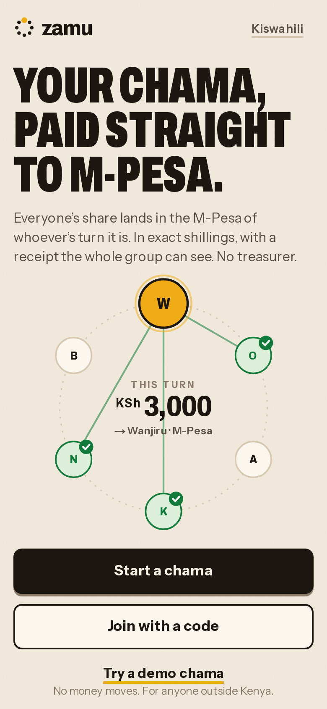
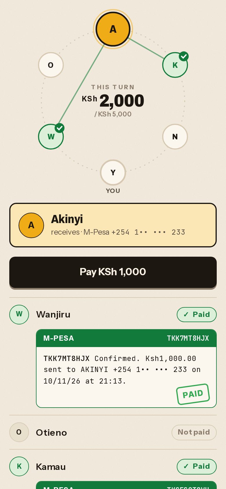
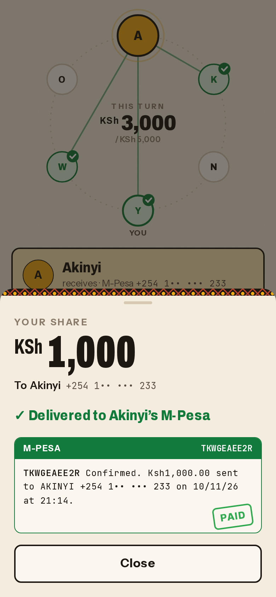

# Zamu

A chama where, when it's your turn, everyone's share lands straight in your M-Pesa in exact shillings, and the whole group sees every M-Pesa receipt.

Live inside Nimiq Pay: open **Mini Apps → Custom URL** and enter `https://zamu.prashantthakur.dev`, or use [nimpay.app/miniapps/open/zamu.prashantthakur.dev](https://nimpay.app/miniapps/open/zamu.prashantthakur.dev).

<p>
  
  
  
</p>

## How it works

1. Someone starts a chama: share size in KSh, how often, how many people. Members join with a 6-character code and say where their turn should be paid (a Safaricom number, a Lightning address, or a Nimiq address). They tick a box agreeing that the group sees it.
2. The creator fixes the rotation order. Every member signs the agreement text with their Nimiq key (`nimiq.sign()`), and the server checks each signature. Round 1 opens when the last one lands.
3. Each round, members tap Pay. The server fetches a fresh Lightning invoice for the recipient's phone from the payout partner and checks it: mainnet, the exact shilling amount, bound to that phone, not about to expire.
4. Nimiq Pay pays it with `payLightningInvoice()`, swapping the member's NIM or USDT to Lightning. The partner turns it into shillings in the recipient's M-Pesa.
5. Zamu polls the partner by payment hash until the M-Pesa receipt code comes back. Only then does the share show as Paid, with the receipt for everyone. When every share in a round is delivered, the round closes and the next one opens on its date.

Nobody holds the pot at any point. There is no treasurer and no Zamu wallet.

## Nimiq features used

- `payLightningInvoice()` for every M-Pesa and Lightning-address payout, with each error type handled: cancelled, duplicate, outcome unknown (never retried), invalid or expired invoice (one fresh invoice, then ask again), and hosts too old to support it.
- `sign()` for sign-in and for the chama agreement. Signatures are verified server-side with Ed25519 over Nimiq's signed-message format, and the signing key must match the member's address.
- `sendBasicTransactionWithData()` for members who choose to receive NIM, with a memo that binds the transaction to one share. The server verifies it on-chain.
- `sendNewStakerTransaction`, `sendStakeTransaction`, `sendSetActiveStakeTransaction`, `sendRetireStakeTransaction` and `sendRemoveStakeTransaction` for the staked reserve, which keeps NIM staked for your next shares and tells you when to start unstaking.
- `window.nimiqPay.language` (English and Swahili) and `network` (Lightning is blocked with a clear message on testnet).

## Rules the group can count on

- One invoice per member per round. Once Nimiq Pay may have paid it, it is never replaced and the Pay button stays off.
- A share is Paid only when the partner reports the M-Pesa receipt. "Sent" is never shown as green.
- Optional rule at creation: a member's turn is skipped until they have paid every share due so far, so nobody can take their turn and stop paying.
- Each member's on-time record (on time, late, overdue) is on the member list.
- Phone numbers are returned only to members of that chama, and masked (`+254 7•• ••• 678`) for everyone but the owner.

## Numbers

Every figure here comes from `npm run proof` (see [`scripts/proof.ts`](scripts/proof.ts)), which reads the production database and writes [`PROOF.md`](PROOF.md).

<!-- proof:start -->
_Filled in after the real-money test runs. See PROOF.md._
<!-- proof:end -->

For comparison: the World Bank's Remittance Prices Worldwide puts the average cost of sending $200 to sub-Saharan Africa at 8.46% (Q3 2025). M-Pesa Global charges KES 100–500 per transfer plus about 3.5% on the exchange rate. Some corridors are already cheap, though. UK to Nigeria digital transfers average 1.96%, so Zamu does not win on price everywhere. What it removes is the treasurer: the money goes from each member to the recipient, and the group can see that it did.

## Limits

- Members need NIM or USDT in Nimiq Pay before they can pay a share.
- Payouts go to Safaricom phone numbers only. Paybill and Till numbers are not supported by the payout partner.
- The minimum share is KSh 15, and the partner caps a single payment at KSh 50,000.
- The payout partner holds the funds for the seconds between receiving the Lightning payment and sending M-Pesa.
- Lightning invoices from the partner live for two minutes, so Zamu fetches one at the moment you tap Pay.

## Run it locally

```bash
docker run -d --name zamu-pg -e POSTGRES_PASSWORD=zamu -e POSTGRES_USER=zamu -e POSTGRES_DB=zamu -p 5443:5432 postgres:17-alpine
cp .env.example .env.local      # set AUTH_SECRET and CRON_SECRET; MOCK_PAYOUTS=1 and NEXT_PUBLIC_MOCK_NIMIQ=1 for a desktop browser
npm install
npm run db:migrate
npm run dev                     # or npm run dev:lan to open it from Nimiq Pay on your phone
```

With the two mock flags, a desktop browser gets a mock wallet that makes real Nimiq signatures and a fake payout partner, so the whole round can be clicked through without money. Phones ending in `000` fail, `111` stay pending.

Tests: `npm run test:unit`, `npm run test:integration` (needs the database), `npm run test:e2e` (Playwright at 360×780). See [TESTING.md](TESTING.md).

Deploy to AWS (ap-south-1): `./infra/build-web.sh && npx sst deploy --stage production`. That is the Next.js standalone server on Lambda behind API Gateway, RDS PostgreSQL with SSL forced, and a 5-minute scheduled job that opens due rounds and re-checks payouts. Set `AuthSecret` and `CronSecret` with `npx sst secret set` first, then apply migrations from inside AWS with `aws lambda invoke --function-name zamu-production-migrate /dev/stdout`.

## License

MIT. See [LICENSE](LICENSE).
