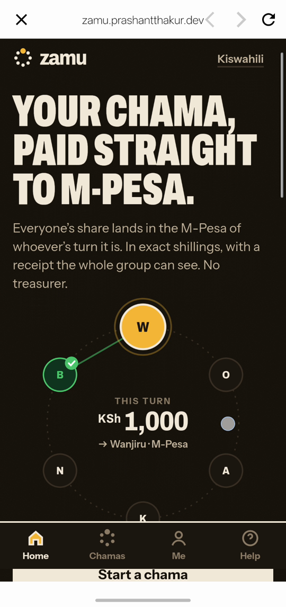
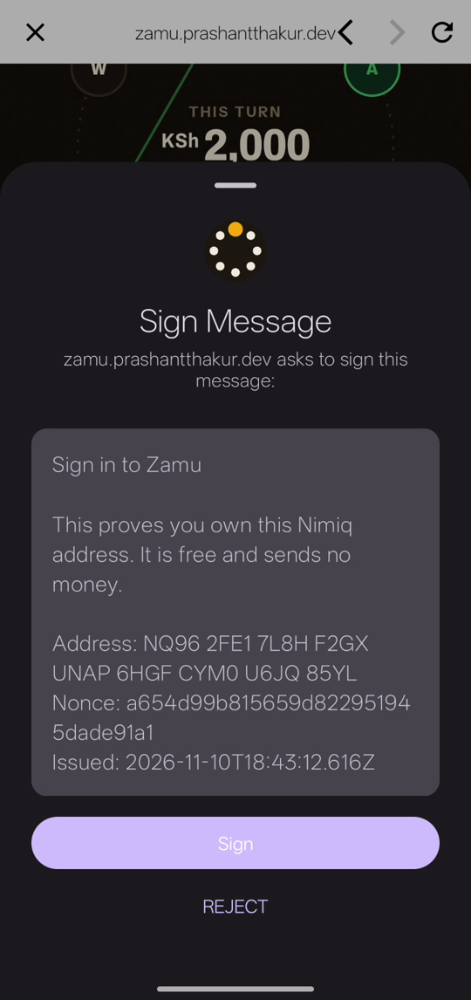
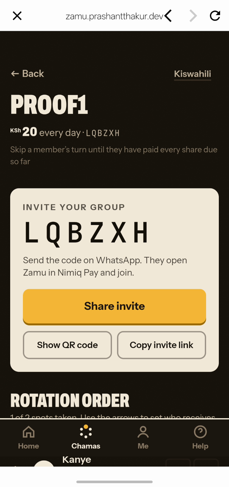
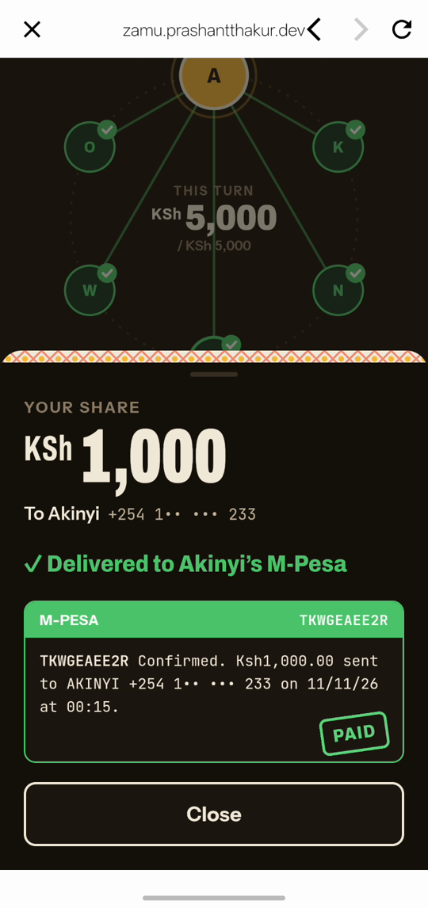
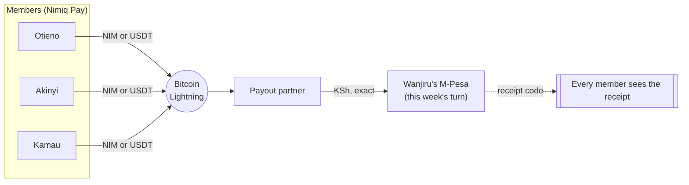
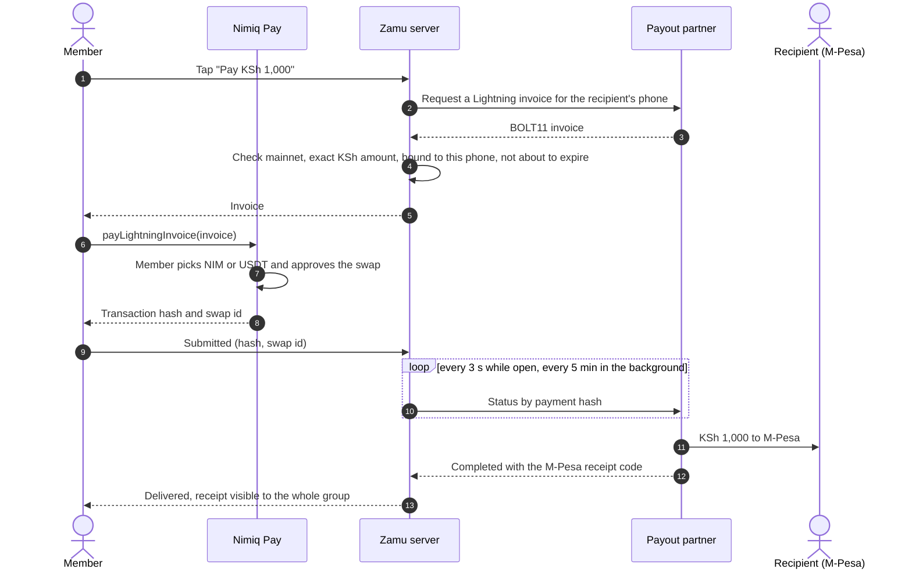
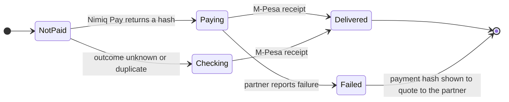
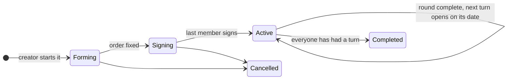
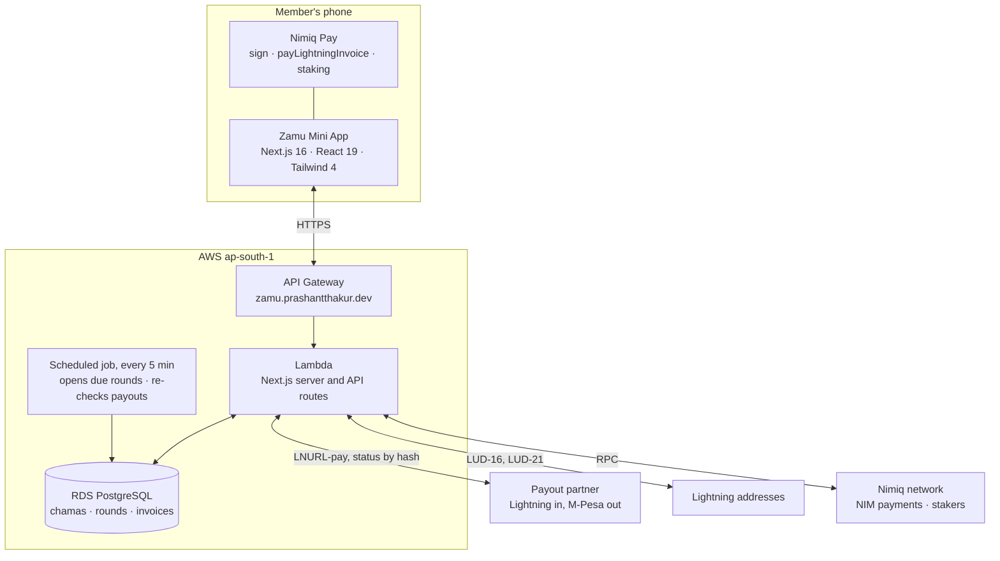

<p align="center">
  
</p>

<h1 align="center">Zamu</h1>

<p align="center"><b>Your chama, paid straight to M-Pesa.</b><br/>
When it's your turn, everyone's share lands in your M-Pesa in exact shillings, and the whole group sees every receipt. No treasurer holds the pot.</p>

<p align="center">
  <a href="https://zamu.prashantthakur.dev"></a>
  <a href="https://youtu.be/l7_HeIk76Ig"></a>
  
</p>
<p align="center">
  
  
  
  
  
  
  
  
  <a href="LICENSE"></a>
</p>

---

## Open it

| Where | How |
| --- | --- |
| **Inside Nimiq Pay** (the real app) | Nimiq Pay → **Mini Apps** → **Custom URL** → `https://zamu.prashantthakur.dev` |
| **Any browser** (demo chama, no wallet needed) | [zamu.prashantthakur.dev/demo](https://zamu.prashantthakur.dev/demo) |
| **Demo video** (2:37) | [youtu.be/l7_HeIk76Ig](https://youtu.be/l7_HeIk76Ig) |

<p align="center">
  
  
  
  
</p>
<p align="center"><sub>Inside Nimiq Pay on an Android phone: home, signing in with your Nimiq key, inviting the group, and a share delivered with its M-Pesa receipt (demo chama).</sub></p>

## The problem

A chama is how millions of Kenyans save: friends, family, colleagues or market traders each put in the same amount every week or month, and each round one member takes the whole pot, until everyone has had a turn. **8.7 million Kenyan adults** use chamas and other savings groups ([FinAccess Household Survey 2024](https://www.centralbank.go.ke/wp-content/uploads/2024/12/2024-FINACCESS-HOUSEHOLD-SURVEY-MAIN-REPORT.pdf)).

Almost every chama runs the same way: one treasurer collects the money, in cash or on one phone, and the whole group has to trust that person. When the treasurer is late, makes a mistake or disappears, the circle breaks.

## What Zamu does

Zamu removes the treasurer. Every member pays their share **straight to whoever's turn it is**, from their own Nimiq Pay wallet, and the money arrives in that person's **M-Pesa in exact shillings**. A share only shows as paid when the **M-Pesa receipt code** comes back, and every member can open every receipt.



### Features

| | |
| --- | --- |
| **Paid straight to M-Pesa** | Each share is a Lightning payment from Nimiq Pay that the payout partner delivers to the recipient's Safaricom number, in exact shillings. |
| **Receipts for everyone** | "Paid" means an M-Pesa receipt came back, not "sent". The Receipts tab lists every receipt in the chama. |
| **Signed agreement** | Members sign the share, schedule and rotation order with their own Nimiq key (`nimiq.sign()`), and the server verifies every signature. "Agreement signed by n/n" is shown on every chama. |
| **Skip-until-paid-up rule** | Optional at creation: a member's turn waits until they have paid every share due, so nobody can take their turn and stop paying. |
| **On-time record** | Each member's record (on time, late, overdue) is visible to the group, and your own across every chama is on the **Me** page. |
| **Never pay twice** | One invoice per member per round. If Nimiq Pay can't tell whether a payment went out, Zamu holds it as "Checking" and never offers Pay again for that share. |
| **Receive anywhere** | M-Pesa in Kenya, any Lightning address worldwide, or a Nimiq wallet: useful for diaspora members. |
| **Staked reserve** | Keep NIM staked for your next shares, see how many it covers, and get told when to unstake before pay day. |
| **Pot planner** | Move the sliders to see what each turn receives, how long a cycle lasts and when your turn lands, then start that chama in one tap. |
| **Invite in seconds** | A 6-character code, a QR code, a copyable link and a WhatsApp-ready message. |
| **English and Kiswahili** | Every screen, following Nimiq Pay's language setting. |
| **Demo chama** | The full round with sample members and receipts, no money and no wallet, for anyone outside Kenya. |
| **Phone and desktop** | Built for the Nimiq Pay WebView at 360 px; on a desktop the app sits in a phone frame beside a short explainer. |

## How a round works



A share moves through these states, and only a delivered share counts toward the round:



A chama becomes active once everyone has signed:



## Nimiq Pay integration

| Nimiq Pay feature | Used for | Code |
| --- | --- | --- |
| `payLightningInvoice()` | Paying every share (M-Pesa and Lightning-address payouts); NIM or USDT swapped to Lightning | [`components/pay-sheet.tsx`](components/pay-sheet.tsx) |
| `NimiqProviderError` types | `PERMISSION_DENIED`, `DUPLICATE_PAYMENT`, `TRANSACTION_OUTCOME_UNKNOWN` (never retried), `INVALID_REQUEST` / `INVALID_TRANSACTION` (one fresh invoice), `UNKNOWN_REQUEST` (update prompt) | [`components/pay-sheet.tsx`](components/pay-sheet.tsx), [`lib/client/nimiq.ts`](lib/client/nimiq.ts) |
| `sign()` | Sign-in and the chama agreement: Ed25519 over Nimiq's signed-message format, verified on the server and bound to the member's address | [`lib/nimiq-sig.ts`](lib/nimiq-sig.ts), [`app/api/auth/verify/route.ts`](app/api/auth/verify/route.ts) |
| `sendBasicTransactionWithData()` | Members who receive in NIM: a memo binds each transaction to one share, and the server verifies it on-chain | [`lib/shares.ts`](lib/shares.ts) |
| `sendNewStakerTransaction`, `sendStakeTransaction`, `sendSetActiveStakeTransaction`, `sendRetireStakeTransaction`, `sendRemoveStakeTransaction` | The staked reserve | [`app/reserve/page.tsx`](app/reserve/page.tsx), [`lib/stake.ts`](lib/stake.ts) |
| `listAccounts()` | The member's Nimiq address | [`components/app-provider.tsx`](components/app-provider.tsx) |
| `window.nimiqPay.language`, `.network` | Kiswahili or English; Lightning blocked with a clear message on testnet | [`components/app-provider.tsx`](components/app-provider.tsx) |

## Architecture



Every invoice is checked on the server before a member can pay it ([`lib/lightning.ts`](lib/lightning.ts), [`lib/tando.ts`](lib/tando.ts)): Bitcoin mainnet only, the exact shilling amount at the partner's published rate, bound to the recipient's phone or Lightning address, and enough time left to pay. Delivery is read back from the partner by payment hash ([`lib/shares.ts`](lib/shares.ts)), and a round closes only when every member's share is delivered ([`lib/rounds.ts`](lib/rounds.ts)).

## Who it's for

Kenyan chama members, at home and in the diaspora. The person receiving needs nothing but M-Pesa; members abroad can receive to a Lightning address or a Nimiq wallet instead. Typical groups: office colleagues, family circles, church groups, market traders, boda riders.

## Costs

There is no Zamu fee. On live quotes from the payout partner, the payout leg costs about **1–1.5% over the partner's published shilling rate**, plus the Nimiq Pay swap from NIM or USDT to Lightning, which the wallet shows before you approve. For comparison, the World Bank puts the average cost of sending $200 to sub-Saharan Africa at 8.46% (Remittance Prices Worldwide, Q3 2025), and M-Pesa Global charges KES 100–500 plus about 3.5% on the exchange rate. Some corridors are already cheap (UK to Nigeria digital transfers average 1.96%), so Zamu's main gain is removing the treasurer rather than price everywhere.

## Limits

- Members need NIM or USDT in Nimiq Pay to pay a share.
- M-Pesa payouts go to Safaricom phone numbers (no Paybill or Till).
- A share is KSh 15 to KSh 50,000 per payment.
- The payout partner holds funds for the seconds between the Lightning payment and the M-Pesa transfer.
- Zamu isn't in Nimiq Pay's Mini App directory yet, so it opens through **Mini Apps → Custom URL**.

## Run it locally

```bash
docker run -d --name zamu-pg -e POSTGRES_PASSWORD=zamu -e POSTGRES_USER=zamu -e POSTGRES_DB=zamu -p 5443:5432 postgres:17-alpine
cp .env.example .env.local      # set AUTH_SECRET and CRON_SECRET
npm install
npm run db:migrate
npm run dev                     # or npm run dev:lan to open it in Nimiq Pay on your phone (Mini Apps → Custom URL)
```

For a desktop browser without a wallet, set `MOCK_PAYOUTS=1` and `NEXT_PUBLIC_MOCK_NIMIQ=1` in `.env.local`: a local mock wallet makes real Nimiq signatures and a fake payout partner answers, so a whole round can be clicked through. Both switches only work on localhost and can never reach production.

```bash
npm run test:unit
npm run test:integration   # needs the local database
npm run test:e2e           # Playwright, phone and desktop
```

## Deploy

```bash
./infra/build-web.sh                         # Next.js standalone build for Lambda
npx sst secret set AuthSecret "$(openssl rand -base64 32)" --stage production
npx sst secret set CronSecret "$(openssl rand -hex 24)" --stage production
npx sst deploy --stage production            # Lambda, API Gateway, RDS, scheduled job, budget alert
aws lambda invoke --function-name zamu-production-migrate /dev/stdout   # database migrations
```

## Project structure

```
app/            screens (home, start, join, chama board, me, help, demo, reserve) and API routes
components/     pay sheet, rotation ring, board, tabs, planner, tab bar
lib/            invoices and payouts (tando, lightning, lnaddress, shares), rounds, chamas, Nimiq signatures, i18n
db/             Drizzle schema and migrations
infra/          Lambda build, scheduled job, migration function
scripts/        proof and smoke scripts
video/          the demo film, built from code
```

## License

MIT. See [LICENSE](LICENSE).
